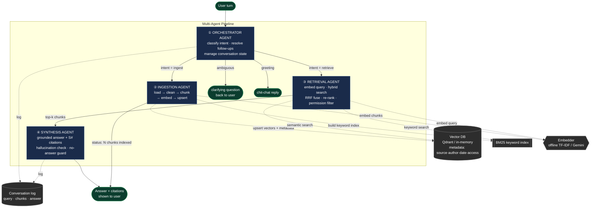

# Architecture — Multi-Agent RAG Framework (one page)

A single user turn flows through four cooperating agents. The Orchestrator routes;
the other three do the work. Everything below the dashed line is shared
infrastructure (vector DB, embedder, indexes) built once at ingestion time.

## Agent boundaries & responsibilities

| # | Agent | Input | Output | Key file |
|---|-------|-------|--------|----------|
| ① | **Orchestrator** | raw user text + history | intent + routing decision + resolved query | `rag/agents/orchestrator_agent.py` |
| ② | **Ingestion** | file path / corpus dir | chunks embedded & upserted + report | `rag/agents/ingestion_agent.py` |
| ③ | **Retrieval** | resolved query + role | top-k chunks with scores & provenance | `rag/agents/retrieval_agent.py` |
| ④ | **Synthesis** | query + retrieved chunks | grounded answer + citations + faithfulness | `rag/agents/synthesis_agent.py` |

## Data flow in words

1. **User turn** enters the **Orchestrator**, which classifies intent and (for
   follow-ups) rewrites the query using remembered conversation state.
2. **Ingest path:** the **Ingestion Agent** loads and cleans documents, splits
   them into chunks (fixed or recursive), embeds each chunk, and upserts them —
   with metadata — into the **Vector DB**, while (re)building the **BM25** index.
3. **Retrieve path:** the **Retrieval Agent** embeds the query, runs **semantic**
   (vector) and **keyword** (BM25) search, fuses the two ranked lists with
   **Reciprocal Rank Fusion**, **re-ranks** the survivors, and drops any chunk the
   user's **role** isn't permitted to see.
4. The **Synthesis Agent** turns the top-k chunks into a grounded answer with
   `[S#]` citations, verifies every sentence traces back to a chunk
   (**hallucination check**), and abstains gracefully when nothing relevant was
   found.
5. **Every turn is logged** (query → retrieved chunks → answer) for evaluation
   and for rendering in a UI.

## Shared infrastructure

- **Vector DB** — Qdrant (in-memory by default; point at a cluster via
  `RAG_QDRANT_URL`). Pure-Python fallback if `qdrant-client` is absent. Stores the
  embedding plus full metadata (`source · author · date · access · doc_type`) so
  retrieval can filter by permission.
- **Embedder** — offline hashed TF-IDF by default; swappable for Gemini
  `text-embedding-004`. The **same embedder is used at ingestion and query time**.
- **BM25 index** — in-process keyword index rebuilt after each ingestion.
- **Two collections** (`northwind_fixed`, `northwind_recursive`) keep the chunking
  strategies separate for fair comparison.

> _This Mermaid diagram renders directly on GitHub and in most Markdown viewers.
> Export to PNG/SVG (e.g. via [mermaid.live](https://mermaid.live)) if a static
> image is required for submission._
